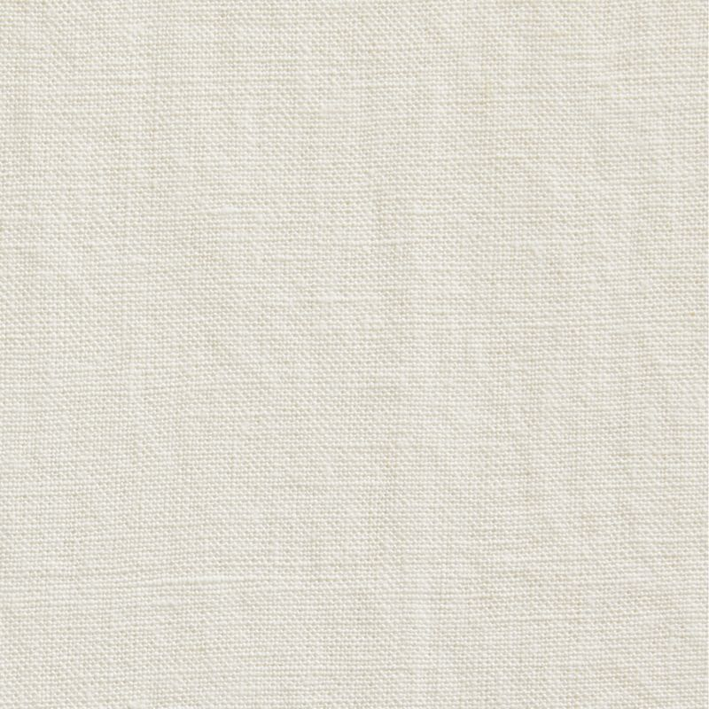

# FAB-1002: Cloudline Blackout

A smooth, ivory blackout fabric with a color-matched backing. A clean, neutral option for nurseries and bedrooms, and the wider roll width makes it our best choice for large windows.

## Metadata

| Field | Value |
|---|---|
| part_number | FAB-1002 |
| title | Cloudline Blackout |
| manufacturer | Vertilux |
| collection | Evolution® |
| fabric_type | Blackout |
| opacity | 100% blackout |
| openness_pct | 0% |
| color | Ivory |
| texture | Smooth |
| backing | Ivory (color-matched) |
| material | Polyester |
| roll_width_in | 118" |
| fire_rating | NFPA 701 |
| price_per_sqft | $2.90 |
| est_price_36x60 | $43.50 |
| status | Active |
| replacement_part | — |
| date_added | 2026-11-01 |
| rights | Sample data for class project |

## Installer notes

- The 118" roll width allows wider shades without a seam. Check width before quoting a seamed shade.
- Because the backing is color-matched, the street side will look ivory, not white. Confirm this is okay with HOA or multi-unit customers.
- Light-colored fabric shows fingerprints. Wear clean gloves during fabrication and install.

[← Back to fabrics catalog](../fabrics.csv)
