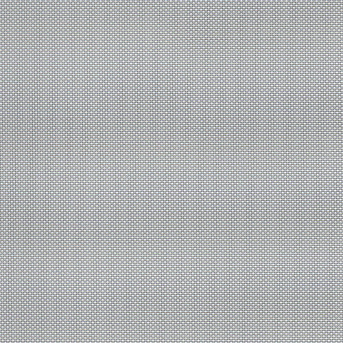

# FAB-1003: Polyscreen Vision® 5% Dove Gray

A 5% openness solar screen in dove gray. It cuts glare and heat while keeping the view outside, making it a popular choice for living rooms, kitchens, and offices.

## Metadata

| Field | Value |
|---|---|
| part_number | FAB-1003 |
| title | Polyscreen Vision® 5% Dove Gray |
| manufacturer | Vertilux |
| collection | Polyscreen Vision® |
| fabric_type | Solar screen |
| opacity | Light filtering |
| openness_pct | 5% |
| color | Dove Gray |
| texture | Basketweave |
| backing | None |
| material | PVC-coated polyester |
| roll_width_in | 98" |
| fire_rating | NFPA 701 |
| price_per_sqft | $3.60 |
| est_price_36x60 | $54.00 |
| status | Active |
| replacement_part | — |
| date_added | 2026-11-01 |
| rights | Sample data for class project |

## Installer notes

- Solar screens give daytime privacy only. At night, with lights on inside, people can see in. Mention this to the customer.
- Darker screen colors give a clearer view outside. Lighter colors reflect more heat.
- Pair with FAB-1001 or FAB-1002 on a dual bracket if the customer wants both view and nighttime privacy.

[← Back to fabrics catalog](../fabrics.csv)
