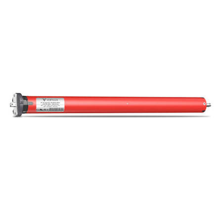

# MTR-2003: VTi® Celtic RF Rechargeable Battery Motor

A wire-free tubular motor with a built-in rechargeable lithium-ion battery and RF remote control. The best choice when there's no power at the window, such as retrofits in finished homes.

## Metadata

| Field | Value |
|---|---|
| part_number | MTR-2003 |
| title | VTi® Celtic RF Rechargeable Battery Motor |
| manufacturer | Vertilux |
| product_line | VTi® Celtic |
| power_type | Rechargeable battery |
| voltage | 12V DC (Li-ion) |
| control_type | RF remote |
| limit_type | Electronic |
| torque_nm | 1.1 Nm |
| max_shade_weight_lb | 10 lb |
| tube_size | 1.5" |
| noise_db | ≤ 42 dB |
| price_each | $215.00 |
| status | Active |
| replacement_part | — |
| date_added | 2026-11-01 |
| rights | Sample data for class project |

## Installer notes

- Fully charge the motor before installing.
- No electrician needed. Leave the charging port reachable so the customer can recharge it.
- Lower lifting capacity than the AC motors. Best for small to medium shades and lighter fabrics like FAB-1003.
- Pair to the remote and set limits the same way as MTR-2001.

[← Back to motors catalog](../motors.csv)
